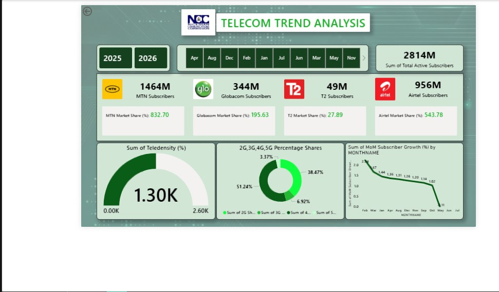

# Telecom Trend Analysis (Power BI)

An interactive Power BI dashboard that tracks Nigeria's mobile telecom market: active subscribers by operator, market share, teledensity, the 2G/3G/4G/5G mix and month-on-month subscriber growth.



## Table of contents

- [Project overview](#project-overview)
- [Business questions](#business-questions)
- [Dataset](#dataset)
- [Tools used](#tools-used)
- [Repository structure](#repository-structure)
- [Data preparation](#data-preparation)
- [Dashboard features](#dashboard-features)
- [Key insights](#key-insights)
- [Recommendations](#recommendations)
- [Known issues and next steps](#known-issues-and-next-steps)
- [How to open the project](#how-to-open-the-project)
- [Author](#author)

## Project overview

Regulators, operators and analysts need a quick view of how the telecom market is changing. This project turns monthly subscriber data into a one-page dashboard that shows who leads the market, how networks are shifting from 2G towards 4G and 5G, and how fast subscriber growth is moving.


## Business questions

1. How many active subscribers does each operator have, and what is each operator's market share?
2. How is the market split between 2G, 3G, 4G and 5G?
3. What is the level of teledensity?
4. How fast are subscribers growing month on month?
5. How do results change by year and month?

## Dataset

- **Source:** [TELECOM] 
- **Period covered:** 2025 to 2026


| Field | Description |
| --- | --- |
| Year and Month | Reporting period |
| Operator subscribers | Active subscribers for MTN, Airtel, Globacom and T2 |
| Total active subscribers | Sum across operators |
| 2G, 3G, 4G, 5G share | Percentage of connections by technology |
| Teledensity | Subscribers per 100 people |
| MoM subscriber growth | Percentage change from the previous month |

## Tools used
- **Microsoft Excel:** data preparation
- **Power BI Desktop:** data model, DAX measures, report design and slicers
- **Power Query:** data cleaning and shaping
- **DAX:** KPI, market share and growth measures

## Repository structure

```
telecom-trend-analysis/
├── README.md
├── data/
│   └── telecom_subscribers.csv
├── powerbi/
│   └── Telecom_Trend_Analysis.pbix
├── screenshots/
│   └── dashboard.png
└── docs/
    └── Project_Summary.pdf
```

## Data preparation

| Step | Action |
| --- | --- |
| Clean and type the data | Set dates, numbers and text correctly; removed blanks and duplicates |
| Build a date table | Year, month name and month number |
| Sort months | Sort month names by month number so they appear in calendar order |
| Build measures | Subscribers, market share, teledensity and MoM growth as DAX measures |

## Dashboard features

- **Slicers:** Year (2025, 2026) and Month
- **KPI cards:** total active subscribers; subscribers and market share for MTN, Globacom, T2 and Airtel
- **Gauge:** teledensity
- **Donut chart:** 2G, 3G, 4G and 5G percentage shares
- **Line chart:** month-on-month subscriber growth
- **Design:** one green theme with consistent cards and operator logos

## Key insights

| Area | Finding |
| --- | --- |
| Operator subscribers | MTN 1,464M, Airtel 956M, Globacom 344M, T2 49M (2,814M in total for the selection) |
| Market share | MTN about 52%, Airtel about 34%, Globacom about 12%, T2 about 2% |
| Technology mix | 4G has the largest share at 51.24%; 2G 38.47%, 3G 6.92%, 5G 3.37% |
| Growth | Month-on-month growth slows from about 2.3% to about 1% over the period, then drops sharply in the final month |

[Market shares above are calculated as each operator's subscribers divided by the total shown on the dashboard.]

**In short**

1. MTN leads the market with roughly half of all subscribers, followed by Airtel.
2. Globacom and T2 together hold only about 14% of subscribers.
3. 4G is now the largest technology, but 2G still carries almost two in five connections.
4. 5G is still a very small share.
5. Subscriber growth is slowing month by month.

## Recommendations

1. **2G users:** target 2G subscribers with device upgrade offers to move them to 4G.
2. **5G:** invest in coverage and handset affordability to lift 5G adoption.
3. **Smaller operators:** Globacom and T2 should focus on retention and data bundles to defend their share.
4. **Growth:** investigate why month-on-month growth is slowing, and whether the final-month drop is real or due to incomplete data.

## How to open the project

1. Download or clone this repository.
2. Open `powerbi/Telecom_Trend_Analysis.pbix` in **Power BI Desktop** (free from Microsoft).


## Author

**Michael Emmanuel**

- LinkedIn: [www.linkedin.com/in/michael-emmanuel-94758b292]
- Email: [michaelemmanuel685@gmail.com]

If you found this useful, feel free to star the repository and share feedback.
